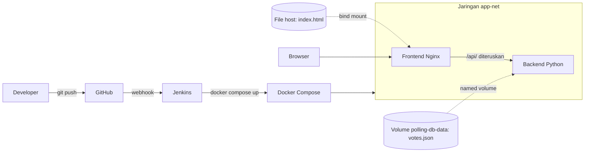

# Sistem Polling / Voting Kampus

Proyek UTS Cloud Computing - Telkom University (Ujian Chunin: Cloud-Native Fullstack Application & Automated CI/CD Pipeline).

## Anggota Kelompok

| Nama | NIM |
| --- | --- |
| [Nama 1] | [NIM 1] |
| [Nama 2] | [NIM 2] |
| [Nama 3] | [NIM 3] |

## Studi Kasus

Studi kasus nomor 7: **Sistem Polling / Voting Kampus**. Pengguna memilih Opsi A atau Opsi B, suara disimpan di `votes.json` pada Docker Named Volume `polling-db-data`, dan perolehan suara tampil real-time di halaman web.

## Fitur API

| Method | Endpoint | Fungsi | Respon |
| --- | --- | --- | --- |
| GET | `/votes` | Perolehan suara A vs B dan daftar catatan | 200 |
| POST | `/votes` | Kirim suara, body `{"option": "A"}` atau `{"option": "B"}` | 201; 400 jika opsi tidak valid, body kosong, atau bukan JSON |
| DELETE | `/votes?index=X` | Hapus catatan suara berdasarkan nomor urut (mulai 0) | 200; 400 jika index bukan angka atau negatif; 404 jika tidak ditemukan |
| GET | `/health` | Cek aplikasi hidup (dipakai Health Check) | 200 |

Seluruh respon berformat JSON. Backend dapat diakses langsung di `http://localhost:5000`, dan lewat frontend di `http://localhost:8081/api/votes`.

## Arsitektur



Alur: developer melakukan `git push` ke branch `main`, GitHub mengirim webhook ke Jenkins, Jenkins menjalankan pipeline 5 stage, lalu Docker Compose membangun ulang dan menjalankan stack. Browser mengakses frontend (Nginx), yang meneruskan permintaan `/api/` ke backend lewat jaringan `app-net` memakai nama service `backend`. Backend menyimpan data di Named Volume sehingga data tetap ada walau container dihapus.

## Struktur Repo

| Berkas | Fungsi |
| --- | --- |
| `app.py` | Backend REST API (Python, tanpa framework) |
| `index.html` | Frontend (HTML dan Vanilla JS, memakai `fetch()`) |
| `nginx.conf` | Konfigurasi Nginx: sajikan `index.html` dan teruskan `/api/` ke backend |
| `Dockerfile` | Image backend |
| `docker-compose.yml` | Definisi stack: 2 container, jaringan `app-net`, named volume `polling-db-data`, bind mount `index.html` |
| `Jenkinsfile` | Declarative Pipeline 5 stage |

## Instalasi Lokal

Prasyarat: Docker dan Docker Compose v2, Git.

```bash
git clone https://github.com/USERNAME/polling-kampus.git
cd polling-kampus
docker compose up -d --build
docker compose ps
```

Buka `http://localhost:8081`. Untuk menghentikan tanpa menghapus data: `docker compose down` (jangan memakai `-v`, karena menghapus volume data).

Uji API cepat:

```bash
curl -i http://localhost:5000/votes
curl -i -X POST -H "Content-Type: application/json" -d '{"option":"A"}' http://localhost:5000/votes
curl -i -X DELETE "http://localhost:5000/votes?index=0"
```

## Bukti Bind Mount

Ubah teks judul di `index.html`, simpan, lalu refresh browser. Perubahan langsung terlihat tanpa build ulang image.

## Bukti Data Immunity (Named Volume)

```bash
docker volume ls                 # ada polling-db-data
docker network ls                # ada app-net
docker rm -f polling-backend     # hapus paksa container backend
docker compose up -d             # buat ulang container
```

Setelah halaman di-refresh, perolehan suara A dan B sama seperti sebelum container dihapus, karena data berada di Named Volume `polling-db-data`.

## Setup Jenkins

1. Pasang Jenkins di mesin Ubuntu yang juga memiliki Docker, Python 3, dan curl. Beri akses Docker: `sudo usermod -aG docker jenkins`, lalu `sudo systemctl restart jenkins`.
2. Buat GitHub Personal Access Token (classic) dengan izin `repo` dan `admin:repo_hook`.
3. Di Jenkins: Manage Jenkins, Credentials, Global, Add Credentials (Kind: Username with password; ID: `github-pat`).
4. Buat job Pipeline bernama `polling-kampus`: centang GitHub hook trigger for GITScm polling; Definition: Pipeline script from SCM; SCM: Git; Repository URL repo ini; Credentials `github-pat`; Branch `*/main`; Script Path `Jenkinsfile`.
5. Buat alamat publik untuk Jenkins (ngrok atau Cloudflare Tunnel) dan isi pada Manage Jenkins, System, Jenkins URL.
6. Di GitHub: Settings, Webhooks, Add webhook. Payload URL `https://ALAMAT-TUNNEL/github-webhook/`, Content type `application/json`, event Just the push event.
7. Lakukan `git push`; build Jenkins berjalan otomatis.

## Pipeline (5 Stage)

| Stage | Fungsi |
| --- | --- |
| Checkout | Mengambil kode terbaru dari GitHub |
| Syntax Check | `py_compile` pada `app.py` dan validasi `docker-compose.yml` |
| Build Image | Membangun image backend |
| Automated Deployment | `docker compose up -d --force-recreate` |
| Health Check | Memastikan `/health` dan `/api/votes` merespons, kalau tidak build gagal |

## Video Demo

[Tempel tautan video di sini]
